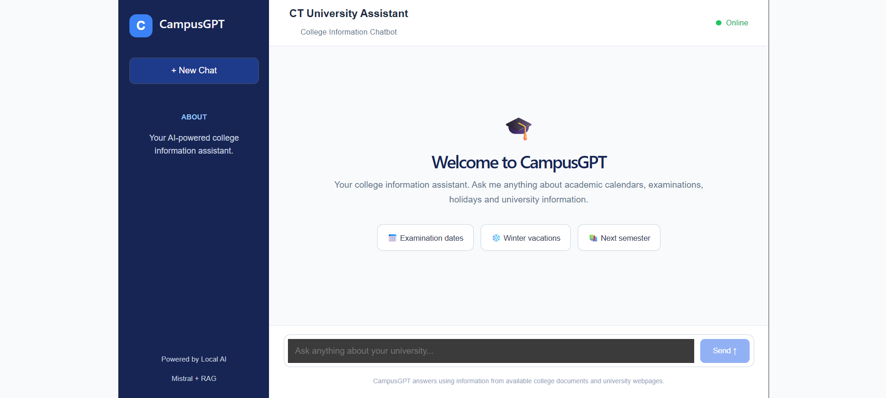
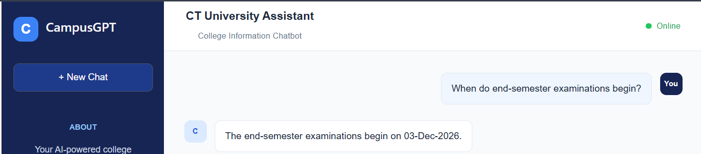
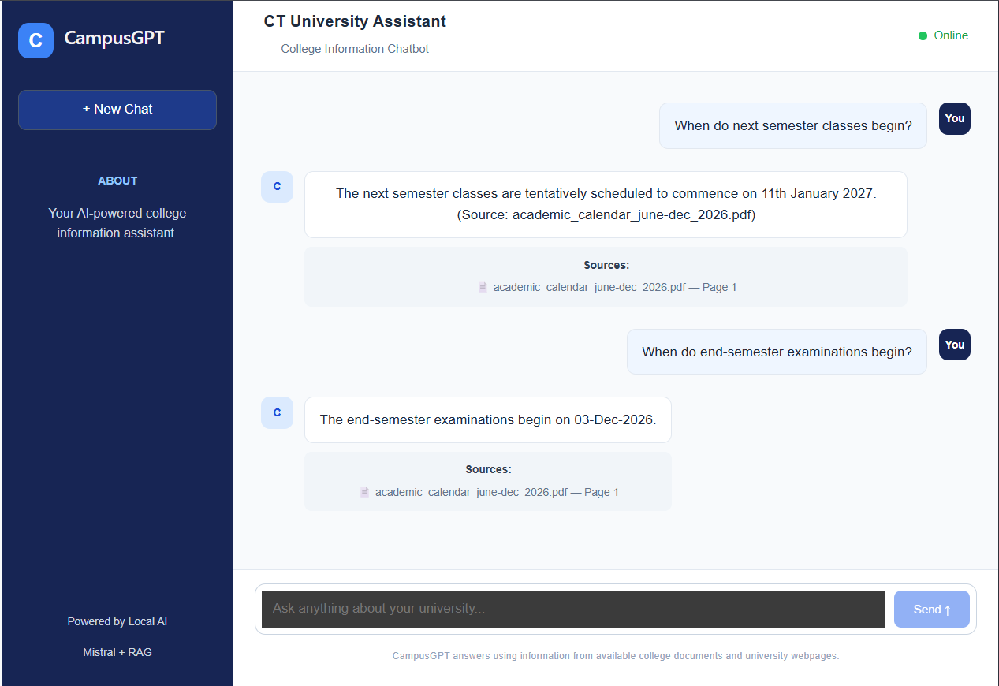

# 🎓 CampusGPT – AI-Powered University Assistant

CampusGPT is an AI-powered university assistant developed using **Retrieval-Augmented Generation (RAG)**. It helps students access university-related information through a conversational chatbot.

The system retrieves relevant information from university documents and website content, then uses a Large Language Model (LLM) to generate context-based answers.

## 🚀 Features

- **AI-Powered Chatbot:** Ask questions about university information in natural language.
- **RAG-Based Retrieval:** Retrieves relevant information from university documents and website content.
- **Semantic Search:** Finds relevant content based on the meaning of the query.
- **PDF Processing:** Extracts and processes information from university PDF documents.
- **Website Data Integration:** Uses information collected from the CT University website.
- **Context-Based Responses:** Generates answers using retrieved information to reduce hallucinations.
- **Source-Based Answers:** Provides relevant source information with responses.

## 🛠️ Tech Stack

| Technology | Purpose |
|---|---|
| Python | Backend development |
| FastAPI | REST API |
| React.js | Frontend |
| Vite | Frontend development |
| ChromaDB | Vector database |
| Sentence Transformers | Text embeddings |
| all-MiniLM-L6-v2 | Embedding model |
| Ollama | Local LLM execution |
| Mistral 7B | Language model |
| PyMuPDF | PDF text extraction |

## 🧠 System Architecture

1. **Data Collection:** Collects university information from PDF documents and website content.
2. **Text Extraction:** Extracts text using PyMuPDF and website processing.
3. **Text Chunking:** Splits extracted content into smaller overlapping chunks.
4. **Embedding Generation:** Converts text chunks into 384-dimensional vector embeddings using all-MiniLM-L6-v2.
5. **Vector Storage:** Stores embeddings in ChromaDB.
6. **User Query:** Accepts questions through the React frontend.
7. **Semantic Retrieval:** Retrieves relevant chunks from ChromaDB.
8. **Answer Generation:** Passes retrieved context to Mistral 7B through Ollama.
9. **Response:** Returns a context-based answer to the user through FastAPI.

## 🖥️ Screenshots

### Chatbot Interface



### Example Conversation



### System Response



> Replace these image paths with your actual uploaded screenshot paths.

## 📂 Project Structure

```text
CampusGPT/
│
├── backend/
│   ├── main.py
│   ├── requirements.txt
│   └── ...
│
├── frontend/
│   ├── src/
│   ├── public/
│   ├── package.json
│   └── ...
│
├── data/
│   └── ...
│
├── .gitignore
└── README.md
```

*Note: Update the folder structure to match the actual project.*

## ⚙️ Installation and Setup

### Prerequisites

- Python 3.11+
- Node.js and npm
- Ollama
- Git

### 1. Clone the Repository

```bash
git clone https://github.com/VGayathrireddy/CampusGPT.git
cd CampusGPT
```

### 2. Backend Setup

```bash
cd backend
python -m venv venv
```

Activate the virtual environment on Windows:

```bash
venv\Scripts\activate
```

Install dependencies:

```bash
pip install -r requirements.txt
```

### 3. Run Ollama

Install Ollama and download the Mistral model:

```bash
ollama pull mistral
```

### 4. Start Backend

```bash
uvicorn main:app --reload
```

### 5. Frontend Setup

Open another terminal:

```bash
cd frontend
npm install
npm run dev
```

Open the local URL displayed by Vite in your browser.

> Ensure the data ingestion/indexing process is completed and the required ChromaDB collection is available before running the chatbot. Configure backend and frontend connection settings according to your project.

## 🎯 Project Objective

The objective of CampusGPT is to make university information easily accessible through an AI-powered conversational interface. By combining semantic search with a Large Language Model, the system provides relevant answers based on available university information.

## 👩‍💻 Developed By

**CampusGPT – Generative AI Project**

Developed as a university-focused RAG-based AI assistant.

---

⭐ If you find this project interesting, consider giving it a star!
